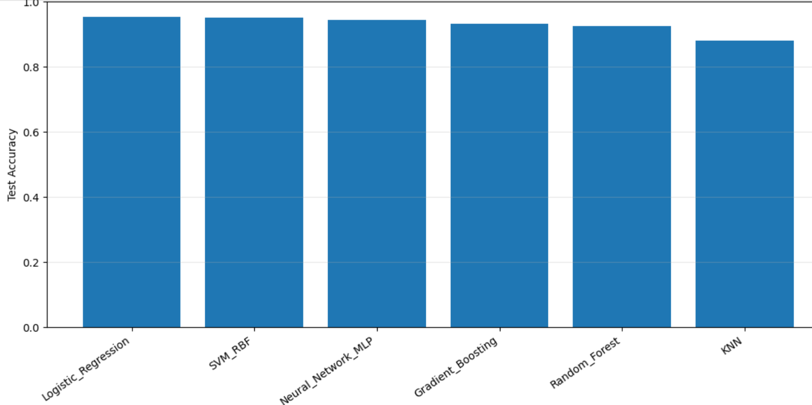
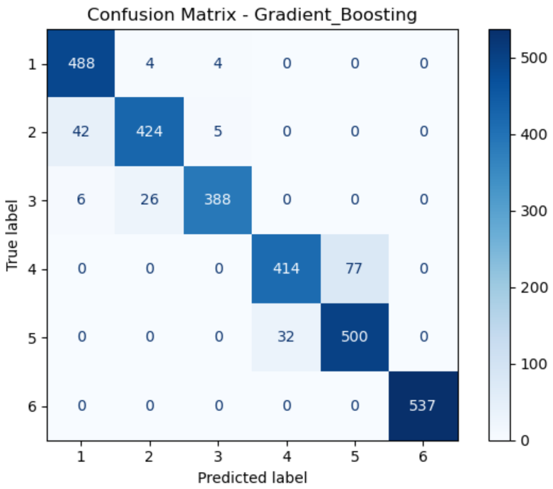
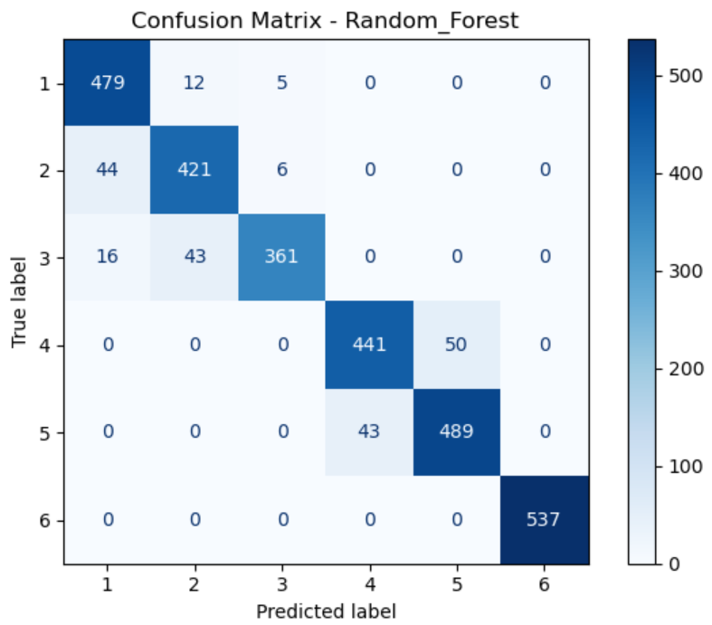
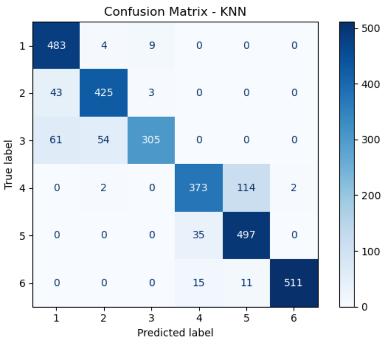

# UCI Human Activity Recognition (HAR) — Data Analysis & Model Benchmarking

## Project overview

This project explores the **UCI Human Activity Recognition Using Smartphones** dataset and builds supervised machine-learning classifiers to recognize six everyday activities from smartphone sensor features.

The work in the notebook follows this sequence:

1. Load the predefined training and test feature matrices and activity labels.
2. Inspect the feature matrix, labels, and activity counts.
3. Attach descriptive feature names from `features.txt`.
4. Explore activity-level patterns and a raw body-acceleration signal window.
5. Train and evaluate several classifiers on the provided train/test split.
6. Compare model performance and save fitted estimators with Joblib.

## Dataset

The notebook expects the following directory layout:

```text
UCI HAR Dataset/
├── features.txt
├── train/
│   ├── X_train.txt
│   ├── y_train.txt
│   └── Inertial Signals/
│       └── body_acc_x_train.txt
└── test/
    ├── X_test.txt
    └── y_test.txt
```

The feature and label files are loaded using Pandas. The feature matrix contains **561 engineered features** per observation.

| Split | Feature rows | Features | Labels |
|---|---:|---:|---:|
| Training | 7,352 | 561 | 7,352 |
| Test | 2,947 | 561 | 2,947 |

### Activity labels

| Label | Activity |
|---:|---|
| 1 | Walking |
| 2 | Walking upstairs |
| 3 | Walking downstairs |
| 4 | Sitting |
| 5 | Standing |
| 6 | Laying |

## Tools and libraries

- Python
- NumPy and Pandas for data loading and tabular inspection
- Matplotlib and Seaborn for visualization
- scikit-learn for preprocessing, classification, and evaluation
- Joblib for saving and loading trained models

## Analysis workflow

### 1. Loading the data

The notebook reads `X_train.txt`, `X_test.txt`, `y_train.txt`, and `y_test.txt`. It checks their dimensions, previews the first few feature values, and counts the training labels.

### 2. Naming the features

The feature names are read from `features.txt` and assigned to the columns of `X_train`. This makes it possible to inspect named variables such as `tBodyAcc-mean()-X` and `tBodyAcc-std()-X`.


The training activity counts recorded in the notebook are:

| Activity | Training windows |
|---|---:|
| Walking | 1,226 |
| Walking upstairs | 1,073 |
| Walking downstairs | 986 |
| Sitting | 1,286 |
| Standing | 1,374 |
| Laying | 1,407 |

### 4. Model training and evaluation

The notebook first evaluates a Random Forest with 100 trees. It then benchmarks five additional classifiers. In the final benchmarking cell, the models are:

- Random Forest (`n_estimators=100`, `random_state=42`)
- Logistic Regression (`max_iter=2000`) inside a `StandardScaler` pipeline
- RBF Support Vector Machine inside a `StandardScaler` pipeline
- K-Nearest Neighbors (`n_neighbors=5`) inside a `StandardScaler` pipeline
- Histogram-based Gradient Boosting (`max_iter=100`, `learning_rate=0.1`)
- Multi-layer Perceptron with hidden layers `(128, 64)`, ReLU activation, Adam solver, `max_iter=300`, and early stopping, inside a `StandardScaler` pipeline

The provided training and test partitions are used directly. Scaling is applied inside pipelines for Logistic Regression, SVM, KNN, and MLP. The notebook does not show a separate feature-selection or dimensionality-reduction stage.

### 5. Evaluation metrics

The notebook reports:

- Accuracy
- Macro precision
- Macro recall
- Macro F1-score
- Weighted F1-score
- Per-class precision, recall, F1-score, and support
- Training and prediction time in the final benchmark

## Results

### Model comparison

The following values come from the final benchmark output in the notebook.

| Model | Accuracy | Macro F1 | Weighted F1 | Training time (s) | Prediction time (s) |
|---|---:|---:|---:|---:|---:|
| Logistic Regression | **0.9549** | **0.9546** | 0.9548 | 2.0608 | 0.0216 |
| SVM (RBF) | 0.9522 | 0.9515 | 0.9521 | 3.5980 | 3.0848 |
| Neural Network (MLP) | 0.9444 | 0.9442 | 0.9444 | 5.0319 | 0.0278 |
| Gradient Boosting | 0.9335 | 0.9329 | 0.9333 | 29.7057 | 0.0617 |
| Random Forest | 0.9257 | 0.9240 | 0.9256 | 2.3749 | 0.0457 |
| K-Nearest Neighbors | 0.8802 | 0.8766 | 0.8790 | 0.1009 | 0.7623 |



Below are the confusion matrix for the models

<div align="center">
  
  
  
  
  
  
</div>

### Best-performing model

**Logistic Regression** achieved the highest test accuracy (**95.49%**) and macro F1-score (**0.9546**) in the final benchmark. Its prediction time was approximately **0.022 seconds** for the test set, according to the notebook output.

The notebook's Logistic Regression classification report gives the following per-class F1-scores:

| Activity label | Activity | F1-score | Test support |
|---:|---|---:|---:|
| 1 | Walking | 0.97 | 496 |
| 2 | Walking upstairs | 0.95 | 471 |
| 3 | Walking downstairs | 0.96 | 420 |
| 4 | Sitting | 0.92 | 491 |
| 5 | Standing | 0.93 | 532 |
| 6 | Laying | 1.00 | 537 |

The reported results suggest that the selected engineered features separate the six activities well. In this benchmark, Logistic Regression slightly outperformed the RBF SVM, while KNN had the lowest accuracy and Gradient Boosting had the longest training time. These are results for this notebook's configuration and supplied split, not a claim that the same ranking will hold for every experiment.

## Model artifacts

The final notebook cell creates a `models/` directory and saves the fitted estimators as Joblib files. It also writes `benchmark_results.csv`.

Expected output structure after running the final benchmarking cell:

```text
models/
├── Random_Forest.joblib
├── Logistic_Regression.joblib
├── SVM_RBF.joblib
├── KNN.joblib
├── Gradient_Boosting.joblib
├── Neural_Network_MLP.joblib
└── benchmark_results.csv
```

The notebook demonstrates loading the saved MLP model:

```python
import joblib

model = joblib.load("models/Neural_Network_MLP.joblib")
predictions = model.predict(X_test)
print(predictions[:10])
```

## How to run

1. Download and extract the UCI HAR dataset.
2. Place the extracted `UCI HAR Dataset/` directory beside the notebook.
3. Install the required packages:

```bash
pip install numpy pandas matplotlib seaborn scikit-learn joblib jupyter
```

4. Open and run `UCI HAR_processing.ipynb` from top to bottom:

```bash
jupyter notebook
```

## Repository layout

A suggested repository structure is:

```text
.
├── UCI HAR_processing.ipynb
├── README.md
├── figures/
│   ├── activity_distribution.png
│   ├── model_accuracy.png
│   ├── model_macro_f1.png
│   ├── training_time.png
│   └── logistic_regression_class_f1.png
├── UCI HAR Dataset/        # download separately; not included here
└── models/                 # generated when the final notebook cell runs
```

## Conclusion

This notebook combines feature-level exploration with a six-model classification benchmark for smartphone-based human activity recognition. The best result in the recorded experiment was obtained by **Logistic Regression**, with **95.49% test accuracy** and **0.9546 macro F1**. The final code also saves each trained model and the benchmark table for later reuse.

## Notes

In layman terms we are using the descriptive statistics of the smartphone-based human activity recognition sensor signals as the feature to these six supervised models, and then the predictions are curated based on the statistics.
This Repo will help you to able to see how supervised models are trained for Exploratory data analysis of signals refer to the other repository: Human-Action-Recognition-EDA under my repository list.
